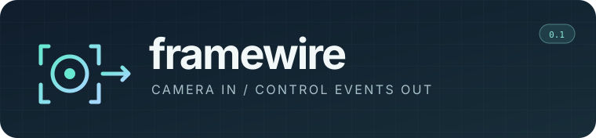
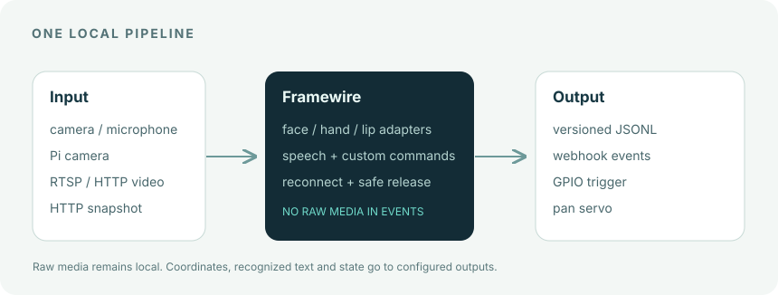
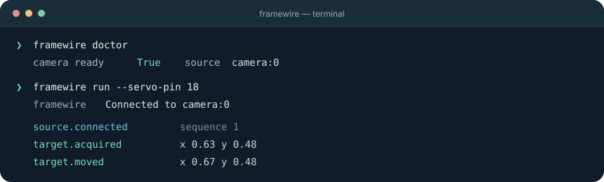

<p align="center"></p>

<h1 align="center">Give a camera something useful to do.</h1>
<p align="center">A headless, local-first bridge from cameras, hands, visual commands and speech to events and actuators.<br>No account. No required config file. Add only the adapters you need.</p>

<p align="center"><a href="#start-in-a-minute">Start</a> · <a href="#choose-an-input">Inputs</a> · <a href="#add-hands-voice-or-visual-commands">Adapters</a> · <a href="#connect-an-output">Outputs</a> · <a href="#when-things-go-wrong">Recovery</a> · <a href="docs/events.md">Event contract</a></p>

<p align="center"></p>

## The problem

Getting from “I have a camera” to “move this lamp when I move” often means writing the same glue again: find a video source, decode frames, detect something, smooth jitter, map coordinates to a motor, deal with unplugged USB devices and reconnect a network stream. Hand signs, spoken commands and custom recognition add another pile of one-off code. The happy-path script is short. The script that can live on a desk is usually not.

**Framewire gives that glue one small CLI.** It discovers a local camera, follows the largest visible frontal face by default, emits newline-delimited JSON events, and keeps trying when a source disappears. Copy an adapter into Framewire's adapter folder to add two-hand gestures, microphone commands, short personalized visual commands or your own detector. You can add a Pi GPIO output, a pan servo or a webhook when you need one. Framewire sends *coordinates and state*, not video or audio, to its outputs.

## Start in a minute

Python 3.10+ is required. Install from this repo:

<details open><summary><strong>macOS / Linux</strong></summary>

```sh
git clone https://github.com/IamAngusU/framewire.git
cd framewire
python3 -m venv .venv
. .venv/bin/activate
python -m pip install -e .
framewire doctor
framewire run
```

</details>

<details><summary><strong>Windows PowerShell</strong></summary>

```powershell
git clone https://github.com/IamAngusU/framewire.git
cd framewire
py -3 -m venv .venv
.\.venv\Scripts\Activate.ps1
python -m pip install -e .
framewire doctor
framewire run
```

</details>

No camera handy? Run `framewire demo`. It sends the same event shape with a moving synthetic point and touches no hardware.

<p align="center"></p>

`framewire run` writes **JSONL to stdout** and human status to stderr. Stop with Ctrl+C. With no output flags or installed adapters, it only observes and emits events, so you can inspect the stream before connecting any hardware.

```json
{"schema":"framewire.event.v1","time":"2026-10-14T10:00:00+00:00","sequence":2,"type":"target.acquired","source":"camera:0","target":{"x":0.63,"y":0.48,"size":0.05,"kind":"face"}}
```

`x` and `y` run from 0 to 1 across the frame. `size` is the fraction of frame area covered by the detection. The face mode detects a face location; it does not identify a person.

## Choose an input

| You have | Run this | Notes |
| --- | --- | --- |
| Built-in or USB webcam | `framewire run` | `auto` tries cameras 0–2, then Picamera2 on Linux. |
| A specific webcam | `framewire run --source 1` | Camera indexes depend on the OS. |
| Raspberry Pi camera | `framewire run --source picamera` | Use the Pi setup below. |
| RTSP camera | `framewire run --source 'rtsp://host/live'` | Open/read timeouts are used with OpenCV's FFmpeg backend. |
| HTTP video / MJPEG | `framewire run --source 'http://host/stream'` | The URL must deliver a decodable video stream. |
| HTTP JPEG/PNG endpoint | `framewire run --source 'http://host/snapshot.jpg' --snapshot` | Fetches one bounded image per sample. |

For a moving object instead of a face, add `--track motion`. Motion mode learns the background for its first 12 frames. It follows the largest moving region, which may be a pet, a hand or a changing screen; it is not object recognition. Use `--track none` if an adapter handles recognition and you do not need target tracking. Both built-in modes are intentionally lightweight and offline.

The default detector follows the **largest frontal face** if several faces are visible. It is a starter tracker for desk projects, not a multi-person identity system. To tune responsiveness, see `framewire run --help` (`--fps`, `--lost-after`, `--deadzone`).

## Add hands, voice or visual commands

Adapters are ordinary Python files in the folder printed by `framewire adapters path`. On Windows it is under `%APPDATA%\Framewire\adapters`; on macOS and Linux it uses the usual application-config location. `FRAMEWIRE_HOME` can point elsewhere. **Enabled adapters run automatically with `framewire run`.** Use `--adapter NAME` to select one or `--no-adapters` to temporarily ignore all of them.

The [copyable examples](src/framewire/examples/adapters) live separately from the core. `framewire adapters add NAME` copies one into *your* adapter folder; edit that copy freely. `framewire adapters new NAME` writes a three-method template for your own frame detector or event action. [Adapter guide](docs/adapters.md) · [Event contract](docs/events.md).

### Recognize two hands and gestures

```sh
python -m pip install -e '.[hands]'
framewire adapters add hands
framewire gestures record lamp.on
framewire gestures list
framewire run --track none
```

The hands adapter emits `hand.position` for each detected hand and `hand.gesture` when a sign persists for three frames. It includes left/right hand, normalized position, confidence and `start`/`end` phase. The included model knows **Closed_Fist, Open_Palm, Pointing_Up, Thumb_Down, Thumb_Up, Victory and ILoveYou**. Record your own **static one-hand sign** with `framewire gestures record LABEL` and manage it with `list` / `remove`; only normalized landmarks are saved. The pinned MediaPipe model (about 8 MB) is downloaded and checksum-checked on first use, then cached locally. The first download needs internet; recognition runs locally afterward. Moving or two-hand gestures need a custom adapter or model.

```json
{"type":"adapter.signal","source":"adapter:hands","data":{"adapter":"hands","signal":"hand.gesture","value":"Thumb_Up","hand":"Right","phase":"start","confidence":0.91,"x":0.62,"y":0.47}}
```

### Speak a command in your language

```sh
python -m pip install -e '.[voice]'
framewire adapters add voice
framewire phrases add "licht an" lamp.on
framewire phrases language de
framewire phrases list
framewire run --track none
```

Use `framewire phrases add "phrase" ACTION`, `remove`, `list` and `language CODE` to manage commands without editing a file. The language can be `auto` or a code such as `de`, `en` or `es`. You can also edit `voice.toml` in the adapter folder; it includes English, German and Spanish examples, plus model and microphone settings. CLI mappings override matching TOML phrases. The example uses a local multilingual faster-whisper `tiny` model, downloaded on first use into Framewire's data folder. Microphone audio is processed in memory; it is not recorded to disk or sent to the webhook. **Transcript text is emitted to stdout and any webhook.** The adapter emits `speech.transcript` and, on an **exact normalized phrase match**, `speech.command`. A larger model can improve accuracy but uses more resources. Short phrases and code-switching can be misheard; test commands before attaching an actuator.

### Teach a short silent visual command

```sh
python -m pip install -e '.[lips]'
framewire adapters add lips
framewire lips record lamp.on --repeats 3
framewire lips list
framewire run --track none
```

Framewire prompts you to mouth the label three times to the camera. It stores only short **mouth-landmark sequences** under Framewire's data folder, then compares live motion with those samples and emits `lip.command`. You can record labels in any language and delete one with `framewire lips remove LABEL`. The pinned Face Landmarker model is about 4 MB and is cached after the first download.

This is **personalized, small-vocabulary visual command matching**, not general sentence-level lip reading. Similar-looking words, lighting, angle, facial hair and timing can cause misses or false matches. It is experimental; require a second confirmation for important actions. The same adapter API can host a heavier visual-speech model for open-vocabulary transcription.

### Turn signals into triggers

```sh
framewire adapters add actions
framewire adapters list
```

Edit `actions.toml` to map a `hand.gesture`, `speech.command` or `lip.command` to an action name. Its included rules show built-in and recorded hand signs, spoken commands and visual commands. The example emits an `action.triggered` event and prints the action to stderr. Replace its `print` in `actions.py` with your actuator's SDK call, or consume `action.triggered` through stdout or `--webhook`. No hidden device code is involved.

### Raspberry Pi setup

On Raspberry Pi OS, install Picamera2 from the OS packages so it matches libcamera. Create a virtual environment that can see those packages:

```sh
sudo apt update
sudo apt install python3-picamera2 python3-gpiozero python3-lgpio
python3 -m venv --system-site-packages .venv
. .venv/bin/activate
python -m pip install -e '.[pi]'
framewire doctor --source picamera
```

See the [official Picamera2 manual](https://datasheets.raspberrypi.com/camera/picamera2-manual.pdf) if your camera module needs OS-level setup. `framewire doctor` reads one frame and reports the actual result. It does not move pins.

## Connect an output

### A pan servo for a desk lamp

```sh
framewire run --servo-pin 18 --servo-range 55
```

Pin numbers are **BCM GPIO** numbers. The servo angle maps the camera's horizontal coordinate across the configured range; `--invert-pan` flips direction. `--deadzone 0.04` ignores tiny shifts near center. Start with `--dry-run --no-adapters` to inspect camera events without custom adapter actions. A stable camera mounted separately from the lamp is the intended geometry; camera-on-servo feedback needs a different controller.

Power a servo from a suitable separate supply and share ground with the Pi; the GPIO pin carries only its control signal. Read [hardware notes](docs/hardware.md) before connecting a motor.

### A trigger output

```sh
framewire run --gpio-pin 23
```

GPIO 23 is HIGH while a target is present and LOW when it is lost, when the camera fails and on shutdown. Use this logic signal to feed an appropriate driver or controller. You can combine it with `--servo-pin` using a different BCM pin.

### A webhook or your own actuator

```sh
framewire run --webhook 'http://127.0.0.1:8080/events'
```

Framewire POSTs each event as JSON. To add a bearer token without placing it in shell history, set an environment variable and use `--webhook-token-env MY_TOKEN`. Webhooks run on a bounded background queue; if the receiver is slow or offline, camera tracking continues and stdout remains complete. The webhook is **best effort**, not a durable message queue.

Or pipe stdout into your own process:

```sh
framewire run | python examples/consume_events.py
```

The example prints actions for `target.acquired`, `target.moved` and `target.lost`. Replace those functions with your actuator SDK. [Event fields and delivery behavior](docs/events.md) are documented so you can integrate without importing Framewire internals.

## When things go wrong

| Situation | What Framewire does | What to try |
| --- | --- | --- |
| No camera on startup | Emits `source.lost`, waits, and retries with bounded backoff. Outputs stay inactive. | `framewire doctor`; try `--source 1`. |
| USB unplugged / stream drops | Releases servo signal, sets GPIO LOW, emits loss events, closes the source, reconnects. | Check cable, power or stream URL. No restart needed. |
| Camera driver opens but stops delivering frames | The capture worker reaches its read timeout, is stopped, and the source is retried. | Check the OS camera app or select another `--source`. |
| No face for a moment | Holds the current target for `--lost-after` seconds; then emits `target.lost` and releases outputs. | Increase `--lost-after` for brief occlusion. |
| Webhook is down | Warns on stderr and drops undeliverable webhook events; JSONL stdout still carries them. | Reconnect receiver; use a durable consumer if every event matters. |
| GPIO library or pin fails | Reports the output error. A failing output is disabled so camera/events continue. | Check permissions, pin conflict and Pi packages. |
| Adapter import, model or runtime fails | Emits `adapter.error` and disables that adapter for the current run; other adapters and camera continue. | Check its optional packages, model download and copied source file. |
| No microphone / microphone unplugged | Voice adapter emits `speech.error`, waits and retries; video tracking continues. | Select an input device in the OS and check audio permissions. |

Camera capture runs in a separate process with bounded open/read waits (8/5 seconds). A stuck native driver can therefore be stopped and retried without freezing the event loop indefinitely, although OS cleanup and reconnection may take longer. JSONL is the complete local event stream while the process runs; it is not persisted automatically.

## Interfaces and scope

```text
FrameSource.read() -> BGR frame
Tracker.detect(frame) -> Target | None
EventBus.emit(type, source, target?) -> versioned JSONL + optional webhook
ControlHub.update(target) / release() -> optional GPIO and pan servo
Adapter.on_frame(frame, now) / on_event(event) -> adapter.signal
```

Sources and trackers are small Python adapters in [`src/framewire`](src/framewire). `FrameSource` is a protocol, so another capture device can be added without changing the event contract. User adapters are copyable files in a separate folder; a crashing adapter is disabled without restarting the camera. [The contract](docs/events.md) describes transition ordering, normalized coordinates and sink limits.

The built-in hardware path controls one pan axis and one digital output. Adapters may implement other outputs. Framewire does not include object identity, tilt, calibration for arbitrary optics, a GUI or a hardware safety system. The GPIO output is a logic signal, not a power stage or an interlock. **Do not connect a laser directly or use person-following with a laser without independent hardware safety.**

## Develop and verify

```sh
python -m pip install -e '.[dev]'
pytest -q
ruff check src tests examples
ruff format --check src tests examples
```

Tests cover target transitions, camera loss and recovery, output release, credential redaction, adapter isolation, phrase, hand-pose and visual-command matching, and a real local HTTP snapshot. Hardware and recognition behavior must also be checked on the exact camera, microphone, Pi and actuator you use. See [hardware notes](docs/hardware.md).

MIT licensed. Early 0.2 release; event schema is versioned so integrations can reject an incompatible future format. [Contributing](CONTRIBUTING.md) · [Security](SECURITY.md).
